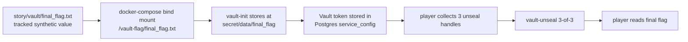

# 16 — Dashboard Flag Investigation (Stillbrook)

**Date:** 2026-11-17
**Scope:** Per-user dashboard flag widget, `story/private_flags/` and the
complete flag lifecycle.
**Method:** Static source review and Git-history inspection. No secret or
flag values are reproduced in this report.

---

## 0. Summary

`story/private_flags/` does **not** exist and never has. It is referenced by
`app/scoring/flag_service.py`, which reads
`story/private_flags/<authenticated-username>.txt`. Because the directory was
never populated, `get_flag_for_session()` returns `None` and the dashboard
template suppresses the flag block. This is **graceful degradation of an
unimplemented feature**, not a broken challenge path.

No replacement flags were created. Doing so would mean inventing flag values
(forbidden), and there is no generated-per-user-flag mechanism in the code.
The smallest correct fix is therefore documentation plus correction of the
unsubstantiated "15 staged flags" claim in `README.md`. The real, working
flag is the final Vault flag, whose lifecycle is intact.

---

## 1. Investigation questions

| Question | Finding |
|---|---|
| 1. Is `story/private_flags/` referenced in source? | Yes — `app/scoring/flag_service.py` (`FLAG_TEXTS_DIR`) and `app/story/__init__.py` (`HIDDEN_FROM_INDEX`, `file()` guard). |
| 2. Is the directory expected to be committed? | No. No per-user flag files exist in the working tree or in any commit. The code guards the path as a *hidden* directory, not a tracked content directory. |
| 3. Are flags generated during initialisation? | No. Neither `scripts/reset_lab.sh` nor `docker/vault/init/vault-init.sh` creates `story/private_flags/` or per-user flag files. |
| 4. Are flags stored in Docker volumes? | No. The only live flag is stored in Vault (`secret/data/final_flag`, in-memory dev backend) and seeded from the tracked `story/vault/final_flag.txt`. |
| 5. Does the dashboard expect static files? | The flag widget expects a static file per username, but it is coded defensively: `if flag` hides the block when the file is absent. |
| 6. Does `.gitignore` exclude the directory? | No explicit rule. Its absence is not caused by ignore rules; the directory was simply never authored. |
| 7. Is the flag-loading path incorrect? | No. The path (`story/private_flags/<user>.txt`) is internally consistent with the story ACL guard. An older name `flag_texts/` is also guarded. It is merely unpopulated. |
| 8. Before or after challenge completion? | There is no completion-gated logic. The docstring describes a planned "Sprint 10" upgrade (HMAC/AES tokens); that feature is not implemented. The widget reads a static file unconditionally for the current session's own user. |

Git-history check: `git log --all --name-only` shows no `flag_texts/` or
`private_flags/` path in any commit. Only `story/vault/final_flag.txt` has
ever existed.

---

## 2. Flag lifecycle (as implemented)



Per-user dashboard flags have **no** lifecycle in the current implementation:

```
Creation:    none (directory never authored)
Storage:     none
Completion:  no completion state tracked per user
Validation:  none
Display:     conditional; hidden when file absent
```

---

## 3. Access-control analysis

The design deliberately avoids leaking one user's flag to another:

- `get_flag_for_session()` takes **no username parameter**; it always uses
  `session["username"]`, set at login. A caller cannot request another
  user's flag.
- `os.path.basename()` neutralises path traversal from the session value.
- `app/story/__init__.py` blocks the `private_flags/` and `flag_texts/`
  prefixes both in the directory index and in the single-file route, so a
  direct URL guess cannot serve flag files even if they were placed under
  `story/`.
- Flags are read from `story/`, which is not a Flask static directory.

Conclusion: no private-flag exposure path exists. No change was needed here.

---

## 4. Actions taken

1. **No static flag files created** — would have meant inventing flags and
   would risk committing fake secrets.
2. **No runtime generation added** — there is no intended per-user flag
   challenge to generate.
3. **Documentation corrected:** `README.md` no longer claims a fixed
   "15 staged flags"; it points to this report and describes the staged
   objectives plus the single final Vault flag.
4. **Code left unchanged** — `get_flag_for_session()` and the dashboard
   template already degrade safely (no exception, no empty flag div, no
   unauthenticated access). Replacing working, safe code is unnecessary and
   would add risk.

---

## 5. Verification

Static verification performed:

- `grep -rn "private_flags\|flag_texts"` — references limited to
  `flag_service.py`, `app/story/__init__.py`, the previous audit report and
  this report.
- `git log --all --name-only | grep -i flag` — only
  `story/vault/final_flag.txt`.
- `docker-compose.yml` and `reset_lab.sh` reviewed: no per-user flag creation
  or volume storage.

Runtime verification (dashboard renders without error, flag block hidden for
users with no flag file, and no flag exposed to unauthenticated requests) is
recorded in `AUDIT_REPORT/18_FINAL_GITHUB_RELEASE_READINESS.md` after the
functional regression and fresh-clone tests.

---

## 6. Remaining risk / conclusion

The dashboard flag widget remains intentionally empty because its backing
content was never authored. This is a documented product limitation, not a
security defect or a broken challenge. The intended, working flag — the
final Vault flag — is unaffected.

**Verdict:** No code fix required; documentation corrected. `story/private_flags/`
should **not** be created. This item is not a blocker for public release so
long as the dashboard is documented as displaying no per-user flag and the
final flag path remains functional.
