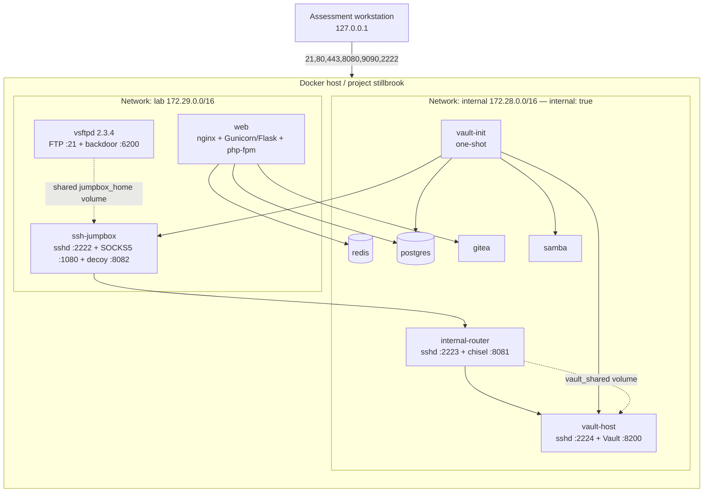
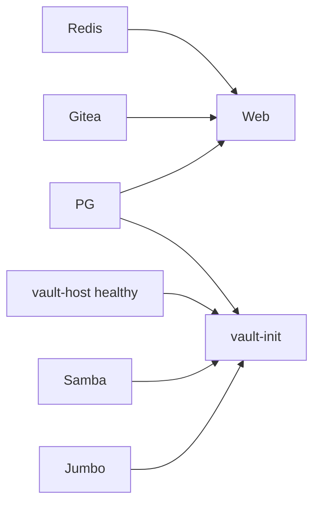
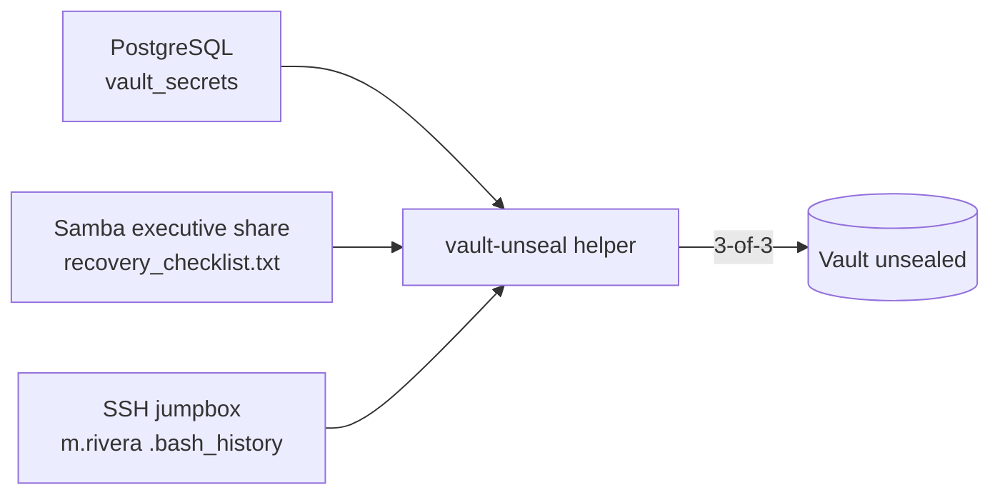

# Stillbrook Architecture

This document describes the **implemented** Stillbrook lab, derived from
`docker-compose.yml`, the Dockerfiles and the entrypoint/init scripts. It is
not a design proposal. Where a capability is planned but not wired up, it is
called out explicitly.

Stillbrook is an intentionally vulnerable enterprise intrusion simulation
for authorised, isolated training. It is **not production software**. All
credentials, hashes and flags are synthetic.

---

## 1. Overall architecture

A single Compose project (pinned as `name: stillbrook`) builds ten services:
nine long-running containers and one one-shot initialiser. The player
reaches the lab from an assessment workstation over a small set of
localhost-bound ports; everything else lives on Docker networks.

- `lab` is a normal bridge network used by player-facing services.
- `internal` is configured with `internal: true`, so its containers cannot
  reach external networks. `scripts/lab_isolation.sh` additionally blocks
  host-to-internal-subnet traffic in the host `OUTPUT` chain so the player
  must pivot through the jumpbox rather than connecting directly.
- The two networks are joined only by containers that legitimately need
  both (`web`, `ssh-jumpbox`).

---

## 2. Docker services

| Service | Image / build | Role | Class |
|---|---|---|---|
| `web` | build `.` | Corporate web app + decoys | Intentionally vulnerable |
| `redis` | `redis:7-alpine` | Session/challenge cache | Supporting infrastructure |
| `postgres` | `postgres:16-alpine` | Challenge DB + unseal key 1 + token | Supporting infrastructure / challenge data |
| `gitea` | `gitea/gitea:1.21-rootless` | Source repo with planted secret in history | Intentionally vulnerable |
| `ssh-jumpbox` | build `docker/ssh` | Password SSH, SOCKS5, decoy chisel | Intentionally vulnerable / pivot |
| `internal-router` | build `docker/router` | chisel server + SSH hop to Vault | Pivot infrastructure |
| `vault-host` | build `docker/vaulthost` | Vault + SSH + privesc vectors | Challenge / secrets |
| `vsftpd` | build `docker/vsftpd` | Backdoored FTP 2.3.4 | Intentionally vulnerable |
| `samba` | build `docker/samba` (`stillbrook/samba:4.19`) | Executive share + unseal key 2 | Challenge data |
| `vault-init` | build `docker/vault/init` | One-shot key scatter + flag write | Initialisation |

`vault-init` is expected to finish with exit code 0 and stay stopped;
`docker compose ps` therefore shows nine running containers plus one exited
`vault-init`.

---

## 3. Service dependencies

`web` uses health-gated `depends_on` for `redis`, `postgres` and `gitea`.
`vault-init` waits for `vault-host` (healthy) and `postgres` (healthy), and
for `samba` and `ssh-jumpbox` to be started, because it writes challenge
material into all of them.

Runtime ordering inside the scripts adds further waits: the router waits up
to 60 s for `/shared/id_rsa`; `vault-init` polls the Vault API and Postgres
readiness before proceeding.

---

## 4. Docker networks

| Network | Subnet | `internal` | Attached services |
|---|---|---|---|
| `lab` | `172.29.0.0/16` | no | `web`, `ssh-jumpbox`, `vsftpd` |
| `internal` | `172.28.0.0/16` | **yes** | `web`, `ssh-jumpbox`, `redis`, `postgres`, `gitea`, `samba`, `internal-router`, `vault-host`, `vault-init` |

Static addresses inside `internal`: `internal-router` = `172.28.0.10`,
`vault-host` = `172.28.0.20`. The jumpbox and router entrypoints add the
matching `/etc/hosts` aliases at runtime (Docker manages that file, so it
cannot be baked into an image).

---

## 5. Host port mappings

All published ports bind to `127.0.0.1` only.

| Host port | Container / port | Purpose |
|---:|---|---|
| 21 | `vsftpd:21` | FTP challenge and backdoor probe |
| 80 | `web:80` | Main application (nginx → Gunicorn/php-fpm) |
| 443 | `web:443` | Self-signed TLS endpoint; 301 redirect to HTTP |
| 2222 | `ssh-jumpbox:2222` | Password SSH jumpbox |
| 8080 | `web:8080` | Fake Tomcat decoy |
| 9090 | `web:9090` | Fake Grafana decoy (always 503) |

Verify with `docker compose ps`, `ss -lntp` and
`nmap -p 21,80,443,2222,8080,9090 127.0.0.1`.

---

## 6. Internal-only services

Redis (6379), PostgreSQL (5432), Gitea (3000), Samba (445), the router
(sshd 2223, chisel 8081), Vault host (sshd 2224, Vault 8200), the vsftpd
backdoor shell (6200) and the jumpbox SOCKS5 proxy (1080) have **no host port
mappings**. They are reachable only from the Docker networks or after the
intended pivot. The vsftpd backdoor listener and the jumpbox decoy chisel
port (8082) exist inside their containers/networks but are not published.

---

## 7. Database architecture

Two distinct data stores are used:

1. **Application identity (SQLite).** `database/users.db` (users) and
   `database/acl.db` (rules) are seeded at **image build time** by
   `seed/seed_db.py` from `seed/users.yaml` and `seed/acl_rules.yaml`. This
   is what Flask authenticates against. It contains Werkzeug password
   hashes, not plaintext. The seeded accounts are synthetic.
2. **Challenge PostgreSQL (`postgres:16-alpine`, volume `pgdata`).**
   `docker/db/init.sql` creates `users` (six rows mirroring the app for DB
   enumeration), `service_config`, and `vault_secrets`. During init,
   `vault-init` adds `key_name`/`key_value` columns, stores unseal handle 1
   in `vault_secrets`, and stores the runtime Vault token in
   `service_config` so the player can retrieve the final flag.

The in-memory data used by `app/finance` and `app/engineering` is **not** a
live connection to Postgres/Redis; `config/medium.yaml` is currently
documentation only and is not read by the application.

---

## 8. Redis usage

`redis:7-alpine` runs with AOF persistence and is seeded at container start
by the bind-mounted `docker/redis/seed_data.sh`. It is reachable from `web`
and other `internal` containers at `redis:6379` with no authentication (a
deliberate weak configuration). `config/medium.yaml` records `auth: none`.

---

## 9. Gitea integration

`gitea/gitea:1.21-rootless` uses a SQLite database in the `gitea_data`
volume, with installation locked and registration disabled. A synthetic
admin (`m.rivera`) and organisation `stillbrook` / repository `web` are
created by `scripts/init_gitea.sh`.

The script copies `docker/git/repo/` into the container and builds **real
Git history**:

- commit 1 adds the app files plus an accidentally committed `.env`;
- commit 2 removes `.env` from the tree, so it remains recoverable from
  history.

The `secrets/ntlm_3f7a2b1c.txt` artifact is part of the challenge content.
The legacy bare repository under `docker/gitea_repos/` is not used by any
build, compose mount or init script (see
`AUDIT_REPORT/17_REPOSITORY_CLEANUP.md`).

---

## 10. SSH jumpbox

Built from `docker/ssh`, the jumpbox publishes only port 2222. It runs:

- `sshd` with password authentication for the synthetic `m.rivera` and
  `backupadmin` accounts (passwords supplied at build time from `.env`);
- a Dante SOCKS5 proxy on container port 1080 for pivoting into the
  `internal` network;
- a "decommissioned" chisel decoy on container port 8082 that accepts a
  connection, sleeps 30 s, then drops it.

Its home volume `jumpbox_home` is shared with `vsftpd`, which is how the FTP
backdoor can read `m.rivera`'s shell history containing unseal handle 3.
The jumpbox adds the router's `/etc/hosts` alias at startup.

---

## 11. Internal router

`internal-router` (`172.28.0.10`) is on the `internal` network only. It runs:

- `sshd` on 2223 for `svc_router` (a synthetic password account);
- a chisel **server** on 8081 with `--reverse` and an auth file that limits
  the account to a single permitted target, `vault-host:2224`;
- a root cron job running `healthcheck.sh` every five minutes.

It copies the router→Vault SSH private key from the `vault_shared` volume at
startup. No private key is baked into the image.

---

## 12. Chisel tunnelling

The intended path is a reverse chisel tunnel: the player connects to the
jumpbox's SOCKS/proxy services and uses chisel through the jumpbox to reach
`internal-router:8081`, then SSHes from the router to the Vault host. The
jumpbox port 8082 is a decoy with no real tunnel. Chisel 1.10.1 is installed
in the router image from a checksum-pinned GitHub release.

---

## 13. Vault architecture

`vault-host` (`172.28.0.20`) runs two daemons in one container:

- `sshd` on 2224, key authentication only for `vault_svc`;
- `vault server -dev -dev-listen-address=0.0.0.0:8200` on the internal
  network. No Vault port is published to the host.

Development mode is deliberate: it auto-initialises with a single bootstrap
share so the one-shot `vault-init` service can authorise a rekey. Its
limitations (in-memory storage, dev-mode bootstrap credentials) are
documented in `AUDIT_REPORT/14_POST_RESET_VERIFICATION.md`. The dev-mode
banner is written to a root-only `/vault/dev-bootstrap.log`, never to
`docker logs`. State is regenerated by a full reset, which is the expected
lifecycle for this lab.

The Vault root token is a fresh runtime value written to `/vault/.vault_token`
(mode `0600`).

---

## 14. Shamir 3-of-3 recovery

`vault-init` rekeys the dev-mode server from 1 share / threshold 1 to a real
**3 shares / threshold 3** quorum. Only the real shares satisfy Vault; the
player collects three synthetic *handles* mapped to those shares in a
root-only key map (`/vault/data/keys.env`) inside the Vault container:

The `/usr/local/bin/vault-unseal` helper translates handles to shares and
runs `vault operator unseal`. `vault-init` also performs a seal/unseal
ceremony to verify the quorum before storing the final flag.

---

## 15. SMB share

`docker/samba` rebuilds the retired `bitnami/samba:4.19` contract from local
source. It creates a synthetic `admin` account (credentials from Compose
env), renders `smb.conf`, and serves the `executive` share from the
`./docker/samba/share` bind mount on the `internal` network (port 445, no
host mapping).

`recovery_checklist.txt` is a **runtime-generated** file: it is created from
the tracked `recovery_checklist.txt.example` template and filled with
unseal handle 2 by `vault-init`. The live file is git-ignored so no generated
secret is committed.

---

## 16. FTP service

`docker/vsftpd` compiles the intentionally backdoored **vsftpd 2.3.4** source
from the tracked `vsftpd-2.3.4.tar.gz` plus a local patch. It publishes port
21 to localhost and runs the classic backdoor shell listener on container
port 6200 (never published). The backdoor runs as `nobody` and reads the
shared `jumpbox_home` volume, which is how handle 3 is discoverable.

---

## 17. Web application

The `web` image contains three request handlers behind nginx:

- **Gunicorn** (22.0.0) serves the Flask app via `stillbrook_wsgi:app` on
  `127.0.0.1:5000`. The WSGI shim exists because the `app/` package shadows
  the root `app.py`; it loads the full root app (all challenge routes) under
  a distinct module name. A single worker is intentional: lockout, WAF-hit
  and IDOR state are process-local by design.
- **php-fpm** on `127.0.0.1:9000` serves `cmd.php`, a concealed webshell that
  bypasses Flask routing and the WAF.
- **nginx** proxies `/` to Gunicorn, serves PHP files via FastCGI, applies
  rate limiting, strips server headers, and provides the 443/8080/9090
  decoy listeners.

The application implements role-gated story access, login/lockout, IDOR,
blind SQL injection and a WAF. Story text lives under `story/` and is served
through `app/story`, with `private_flags/` and `flag_texts/` explicitly
hidden from the index and file routes.

---

## 18. Challenge artefacts

- `story/` — corporate narrative (emails, chats, tickets, CMDB, HR, logs,
  noise, projects, reports, shares, vault notes). Mostly synthetic
  background with planted clues and decoys.
- `docker/git/repo/` — content for the Gitea history challenge (includes a
  synthetic NetNTLMv2 hash).
- `docker/vaulthost/flags/` — synthetic proof markers for SUID, sudo, cron
  and tunnel stages.
- `docker/ssh/.bash_history` — base history; handle 3 is appended at init.
- `docker/vaulthost/vault-reader.c`, `vault_rotate.sh`, `proc-version`,
  `rc.local` — privilege-escalation vectors and the kernel decoy.

All are intentionally vulnerable/synthetic training data and are preserved.
They are not real secrets.

---

## 19. Flag retrieval process

1. `vault-init` stores the contents of `story/vault/final_flag.txt` at
   `secret/data/final_flag` in Vault.
2. It also writes the runtime Vault token to Postgres `service_config`.
3. The player collects the three unseal handles (Postgres, Samba, jumpbox),
   supplies them to `vault-unseal`, and reads the flag with the token.
4. `docker compose exec stillbrook-vault-host sh -c ... vault kv get
   -field=value secret/final_flag` returns the `stillbrook{...}` value.

The per-user dashboard flag widget is a separate, unpopulated feature; see
`AUDIT_REPORT/16_DASHBOARD_FLAG_INVESTIGATION.md`.

---

## 20. Reset and recovery process

`scripts/reset_lab.sh` is the supported recovery path:

1. `docker compose down -v --remove-orphans` — deletes Compose volumes
   (`pgdata`, `gitea_data`, `jumpbox_home`, `vault_shared`). These contain
   only regenerable lab state.
2. `python3 seed/seed_db.py --reset` — rebuilds the SQLite identity DBs.
3. `docker compose up -d --build` — rebuilds current source and starts
   everything, regenerating SSH keys at container start.
4. `scripts/init_gitea.sh` — recreates the Gitea repo and its history.
5. `vault-init` — generates new unseal handles, rekeys 3-of-3, performs the
   seal/unseal ceremony and re-stores the final flag.
6. A verification block runs service/flag checks and reports key locations.

After a reset, regenerate unseal handles and the flag are fresh; no secret
material is persisted in the repository. Vault dev-mode state is lost by
design and rebuilt by the one-shot initialiser.

---

## Classification summary

| Category | Components |
|---|---|
| Host-accessible | `web` (80/443/8080/9090), `ssh-jumpbox` (2222), `vsftpd` (21) |
| Internal Docker services | `redis`, `postgres`, `gitea`, `samba`, `internal-router`, `vault-host`, `vault-init` |
| Intentionally vulnerable | `web` (IDOR/SQLi/WAF/webshell), `vsftpd` 2.3.4 backdoor, jumpbox weak passwords, Gitea secret in history, `vault-host` SUID/sudo/cron vectors |
| Supporting infrastructure | networks, volumes, nginx/php-fpm/gunicorn, chisel, SOCKS5, seed scripts |
